### Hi, I'm Kalyan (Dev)👋

I'm a Cybersecurity grad student at **Northeastern University** (MS, '27), based in Boston.
I build security tools, break things on purpose, and spend a lot of time on how real systems actually fail.

- 🔭 Currently working on post-quantum cryptography (TLS, E2EE messaging, embedded benchmarks), edge security in Rust, and Cloudflare Workers tooling
- 🔬 Research: post-quantum signatures for Cortex-M secure boot, with Prof. Rolando Herrero
- 🌱 Learning kernel internals, eBPF, firmware security, and offensive-sec certification material
- 🛠️ Interests: AppSec · PQC · vuln research · secure code review · embedded security · edge/network security
- 📫 Reach me: [LinkedIn](https://www.linkedin.com/in/gk-eh/) · [Portfolio](https://kalyangopalam.com/) · kalyan.dev.me@gmail.com

---

### 🔧 Projects I actively work on

- **[Cloudflint](https://github.com/Kalyan-Deva/cloudflint)** — edge reverse proxy, WAF and cache written from scratch in Rust (tokio, hyper, rustls): Cloudflare-style filter DSL, request coalescing, stale-while-revalidate, hot-swapped config. 485 tests.
- **pqdoctor / Flarebox** `Private Repo, Still in Development` — post-quantum readiness scanner for TLS and SSH (CLI, web, GitHub Action) inside a Tauri 2 desktop app for running and deploying Cloudflare Workers projects.
- **Quietwire** `Private Repo` — post-quantum end-to-end encrypted chat on Cloudflare Workers: PQXDH, ML-KEM ratchet, sealed sender, multi-device, key transparency, calls.
- **Peregrine** `Private Repo` — hybrid post-quantum TLS 1.3 reverse proxy in Rust (X25519MLKEM768) with handshake telemetry. Measures what PQ costs: ~3.3× the handshake bytes, ~2× the latency.
- **Merlin** `Private Repo` — nRF7002 DK (nRF5340) firmware benchmarking ML-KEM / ML-DSA against hardware-accelerated P-256 on CryptoCell-312, all through PSA on Zephyr.
- **[Numa](https://github.com/Kalyan-Deva/Numa)** — native Android adaptive-schedule and accountability app (Kotlin, Jetpack Compose, Room, Glance widgets).
- **[Lexicon](https://github.com/Kalyan-Deva/Lexicon)** `Private Repo, Still in Development` — knowledge platform with web, application, and terminal clients for structured technical notes.
- **[Bounty-Hawk](https://github.com/Kalyan-Deva/Bounty-Hawk)** — recon and bug bounty workspace for organizing targets, findings, and reports.
- **MITRE eCTF 2026 — NeuSense** — secure embedded design: key derivation, AEAD, replay protection, access control on constrained hardware.
- **Redhawk** *(in progress — public soon)* — new security project, details to follow.

---

### 🚀 Live & Shipped

Things I've deployed, published, or released to the public.

| Release | What it is | Where |
|---|---|---|
| **Lexicon (Web)** | Knowledge platform, live production build | [lexicon.kalyangopalam.com](https://lexicon.kalyangopalam.com) |
| **Lexicon TUI** | Terminal client for Lexicon, published release | [GitHub Release](https://github.com/Kalyan-Deva/Lexicon) |
| **Quietwire** | Post-quantum E2EE chat, live on Cloudflare Workers | [chat.devme.online](https://chat.devme.online) |
| **Connect** | Scan-to-connect card (Worker + D1) for Cloudflare Connect 2026 | [connect.kalyangopalam.com](https://connect.kalyangopalam.com) |
| **Cloudflint** | Rust edge proxy + WAF + cache, public repo with CI | [github.com/Kalyan-Deva/cloudflint](https://github.com/Kalyan-Deva/cloudflint) |
| **Little Hours** | Cozy always-on-top Windows desk widget (Tauri 2 + Rust), v1.0.0 installer | [GitHub Release](https://github.com/Kalyan-Deva/little-hours/releases) |
| **Numa** | Native Android app, signed APK release | [GitHub Release](https://github.com/Kalyan-Deva/Numa/releases) |
| **Bounty-Hawk** | Recon and bug bounty workspace, public repo | [github.com/Kalyan-Deva/Bounty-Hawk](https://github.com/Kalyan-Deva/Bounty-Hawk) |
| **Portfolio** | Personal site, live deployment | [kalyangopalam.com](https://kalyangopalam.com) |

More releases and public builds are on the way — check the [pinned repositories](https://github.com/Kalyan-Deva) for the latest.

---

### 🧰 Tech I use

**Languages**  

**Frameworks & Platforms**  

**Security**  

**Data**  

---

### 📊 GitHub Stats

  
  

---

### 📌 Highlights

- Research on post-quantum signatures for secure boot on Cortex-M, with Prof. Rolando Herrero (Fall 2026)
- Benchmarked ML-KEM / ML-DSA against hardware-accelerated ECC on real nRF5340 silicon (CY5120 Applied Cryptography)
- Built a from-scratch Rust edge proxy + WAF with 485 tests and green CI
- Shipped post-quantum TLS and post-quantum E2EE messaging, end to end
- MITRE eCTF 2026 — secure embedded system (crypto, access control, protocol hardening)
- Hands-on work with honeypots, IDS/IPS, and network monitoring
- Focused on responsible disclosure and practical security engineering
- Attending Cloudflare Connect 2026 (Oct 19–21, San Francisco) — say hi

---

### 📫 Reach out

If you're working on security tooling, post-quantum migration, open-source security projects, or AppSec research — happy to talk.

